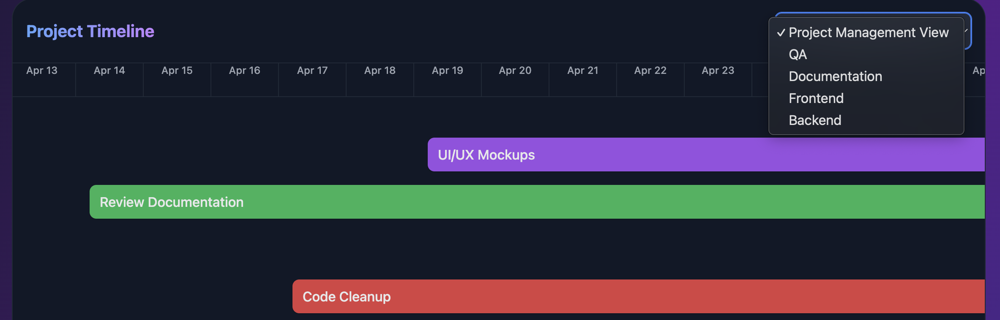
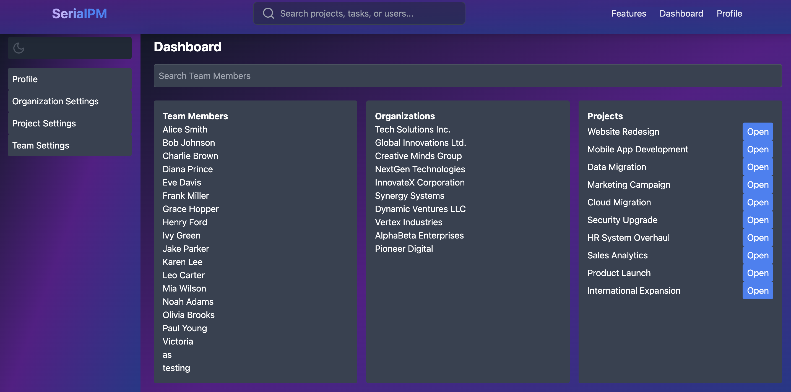
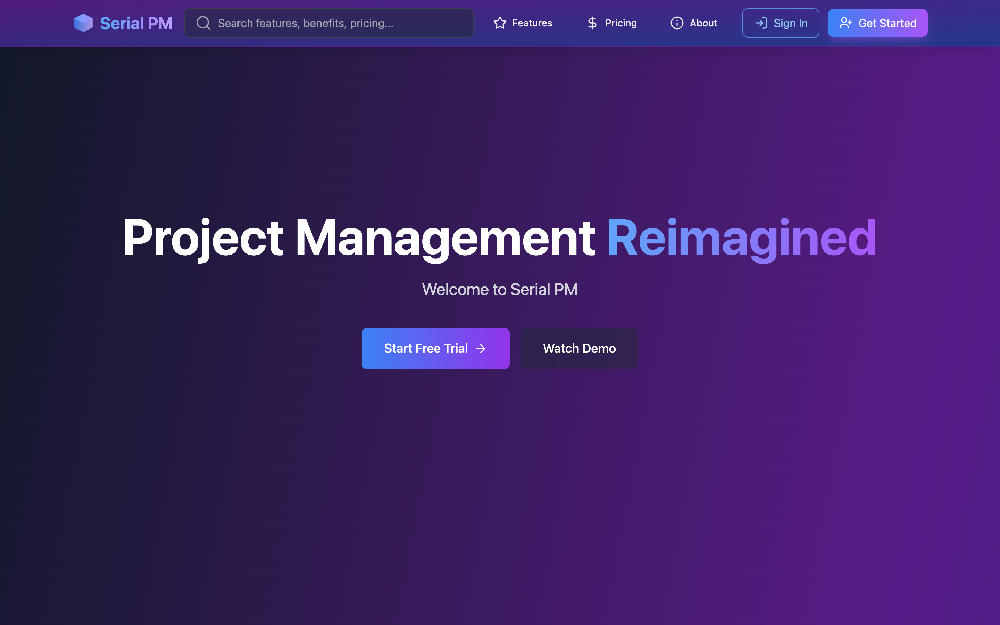
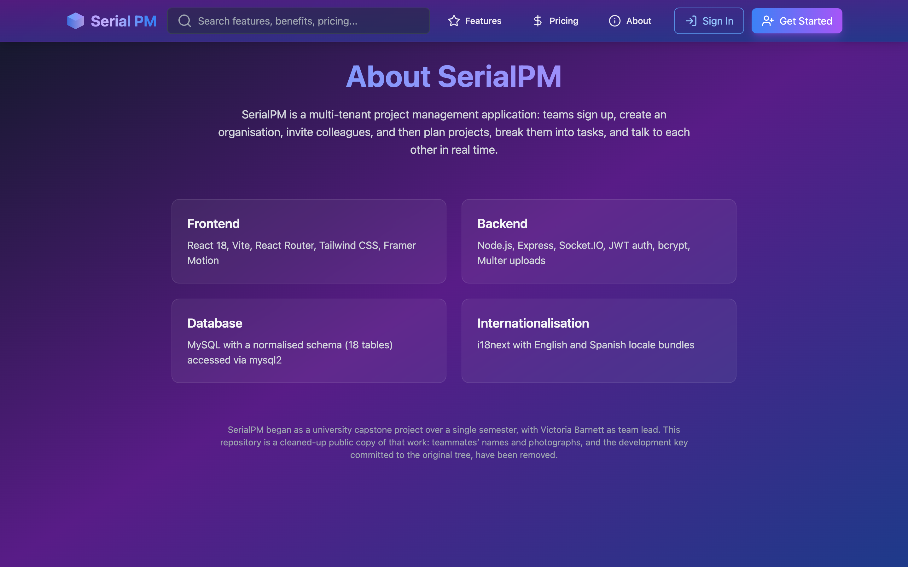
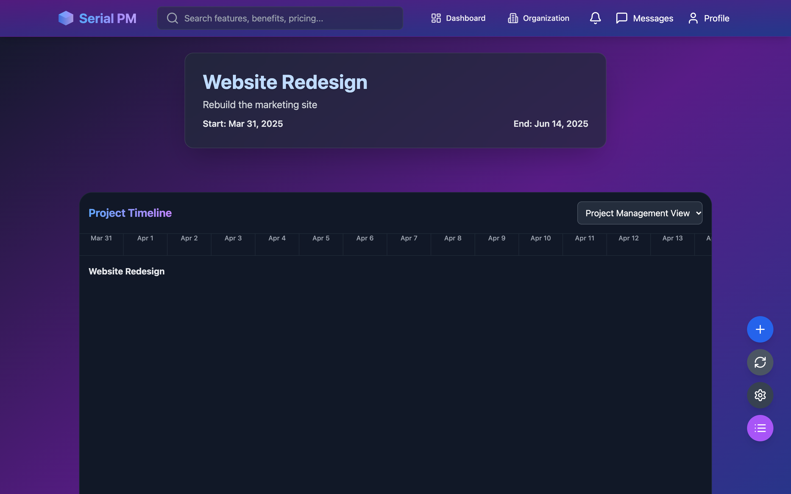
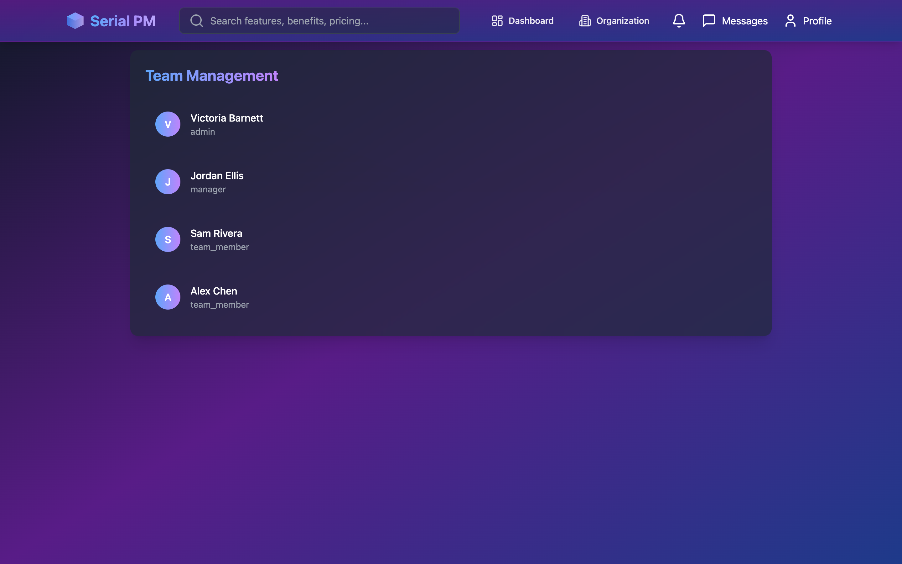

# SerialPM

Front end of a project management app: organisations, projects, tasks, team management
and real-time chat. Built as a university capstone project at San Francisco State
University, led by **Victoria Barnett**.

**This is a front-end showcase.** The backend and database were removed for
publication, so screens that load data (dashboard, project, team, profile) have
nothing to talk to and show empty states. The screenshots below were captured against
the original backend with invented demo data.




| | |
|---|---|
|  |  |
|  |  |

## Stack

React 18, Vite, React Router, Tailwind CSS, Framer Motion, Socket.IO client, i18next
(English and Spanish).

## Run

```sh
npm install
npm run dev     # http://localhost:3000
```
